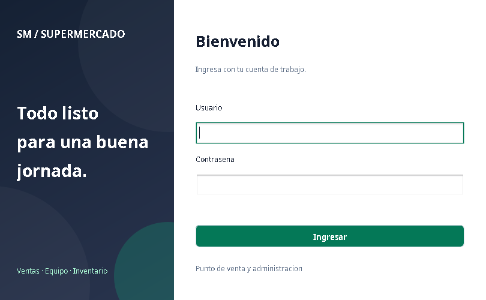
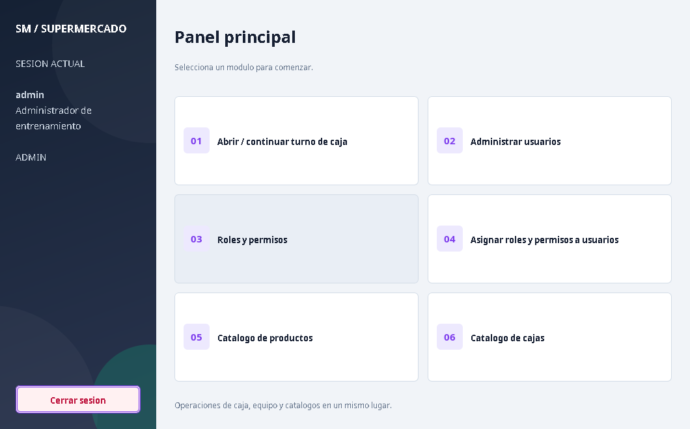
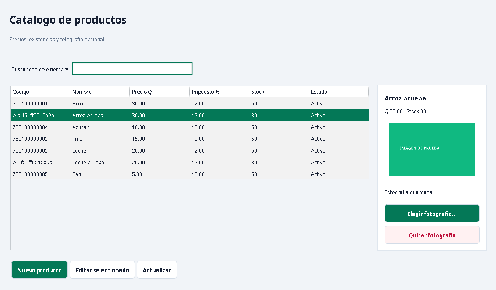

# Diseño visual y fotografías de productos

La aplicación conserva Java 21, Swing y el JDK. El tema usa Nimbus, botones
con esquinas suaves y foco visible, fondos grises claros, encabezados oscuros
y acentos esmeralda/violeta. Inicio y menú tienen un fondo degradado dibujado
con Java; no requieren una imagen externa ni otra biblioteca.

La mejora de fotos es opcional y se integra en el catálogo. Los datos de caja,
precios, existencias, roles y permisos conservan sus reglas.

## Actualizar en Windows

Cierra la aplicación Java, incorpora el pull request a main y ejecuta desde tu
clon, primero comprobando que `git status` indique `working tree clean`:

```powershell
Set-Location "$env:USERPROFILE\Proyectos\SupermarketApp-Git"
git status
```

Si está limpio:

```powershell
git pull --ff-only origin main
powershell -NoProfile -ExecutionPolicy Bypass -File .\scripts\iniciar.ps1
```

Usa la contraseña técnica de Oracle para **pos** en la consola y después tu
cuenta en el login. Esta actualización no cambia el esquema: si ya preparaste
la base y aplicaste la actualización 04, no necesitas ejecutar SQL adicional.

## Añadir una foto

1. Entra como admin o con un usuario que tenga **CATALOGO_ADMIN**.
2. Abre **Catálogo de productos**. Si el producto es nuevo, créalo y guarda
   sus datos antes de añadir su fotografía.
3. Selecciona su fila. La ficha lateral muestra nombre, precio, existencias
   y un marcador cuando todavía no tiene foto.
4. Pulsa **Elegir fotografía...**, selecciona un **JPG/JPEG o PNG de hasta
   10 MB** y confirma. La copia se reduce manteniendo proporción y aparece
   en la ficha del producto.
5. Puedes cerrar y reabrir el catálogo: la foto debe conservarse. Para
   reemplazarla, elige otra. **Quitar fotografía** retira la copia del catálogo
   después de confirmar; el archivo que seleccionaste originalmente se conserva.

Elegir o quitar la foto es independiente de guardar precio, nombre o stock.
Una imagen inválida conserva la foto anterior. El procesamiento se hace fuera
del hilo de eventos para que la ventana siga respondiendo.

## Dónde se guardan y cómo respaldarlas

Las fotografías son archivos locales del proyecto, no columnas nuevas de Oracle:

```text
datos/fotos/pos/<id-del-producto>.png
```

Se vinculan al ID del producto, por lo que cambiar su código o nombre conserva
la fotografía. El contenido importado se guarda como PNG de hasta 720 píxeles
en su lado mayor. La vista previa se ajusta al espacio disponible sin deformar.
Las pruebas usan una carpeta temporal y el esquema `pos_test` por separado.

**Incluye `datos/fotos` en tus respaldos.** Esa carpeta está excluida de Git:
`git pull` conserva tus fotos locales, pero otra clonación o el ZIP de GitHub
no las incluyen. Si mueves el proyecto a otro equipo, copia también esa carpeta
junto con la base correspondiente, conservando los IDs de productos. Las fotos
no se sincronizan entre computadoras automáticamente.

Los cinco productos iniciales no traen fotografías. Puedes usar tus propias
imágenes desde el selector. Los comprobantes y la pantalla de cobro siguen
mostrando sus detalles textuales; esta mejora se centra en el catálogo.

## Pruebas y código

Con POS_TEST ya preparado, puedes comprobar solo esta función:

```powershell
powershell -NoProfile -ExecutionPolicy Bypass -File .\scripts\pruebas-fotos.ps1
```

Pide la clave de Oracle de **pos_test**. Debe indicar **12 correctas, 0 fallos**.
Comprueba PNG/JPEG, proporción, reemplazo, archivos inválidos/grandes, permisos,
separación de esquemas y conservación de los archivos originales y datos SQL.

Tres pruebas de ventanas (`PruebasInterfazFotos`) seleccionan un archivo con
JFileChooser, comprueban la persistencia al reabrir y lo eliminan. La regresión
completa incluye **219 casos**, con **26 gráficos**, sobre Oracle real y Swing
en Linux/Xvfb. El estudiante ya verificó las 100 pruebas rápidas de negocio y
administración en Windows; debe comprobar allí este diseño y la nueva selección
de fotografías.

- `Tema`: paleta, fuentes, cabeceras, miniaturas y tamaño de ventanas.
- `BotonUI`: pintado de botones, estados y foco de teclado.
- `FotoProductoService`: permiso de catálogo y existencia del producto.
- `FotosProducto`: lectura, reducción y reemplazo de la copia administrada.
- `ProductosFrame`: ficha lateral y selección de archivos.

Las capturas siguientes son de ventanas reales. La imagen de color con el texto
IMAGEN DE PRUEBA es un archivo sintético de la suite, no una foto de un producto real.

### Ingreso



### Panel principal



### Catálogo con foto


