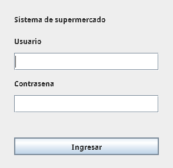
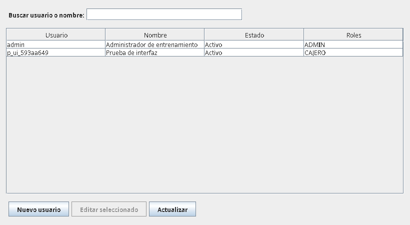
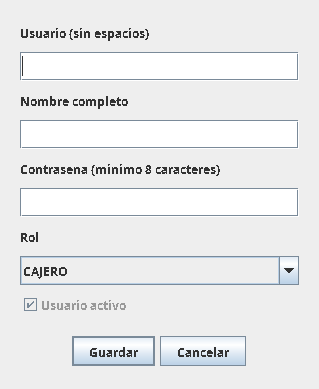
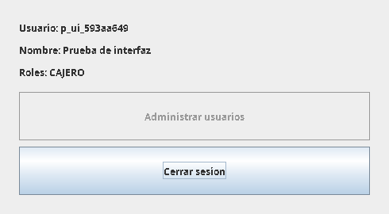

# Evidencias de la tercera etapa

Capturas de ventanas reales ejecutadas en Linux con Xvfb, JDK 21, Oracle XE
21.3 y el driver JDBC 21.11. Corresponden al esquema POS_TEST y datos temporales.
No representan capturas tomadas en Windows ni la finalización de las doce
pantallas exigidas. No contienen claves de conexión.

La prueba automatizada rechazó un login incorrecto, autenticó admin, creó un
cajero desde el formulario y comprobó el menú de ese usuario. Se ejecutaron
cuatro casos, todos correctos. Las filas temporales se eliminaron al finalizar.

## Login

## Lista de usuarios

## Alta de usuario

## Menú del cajero

