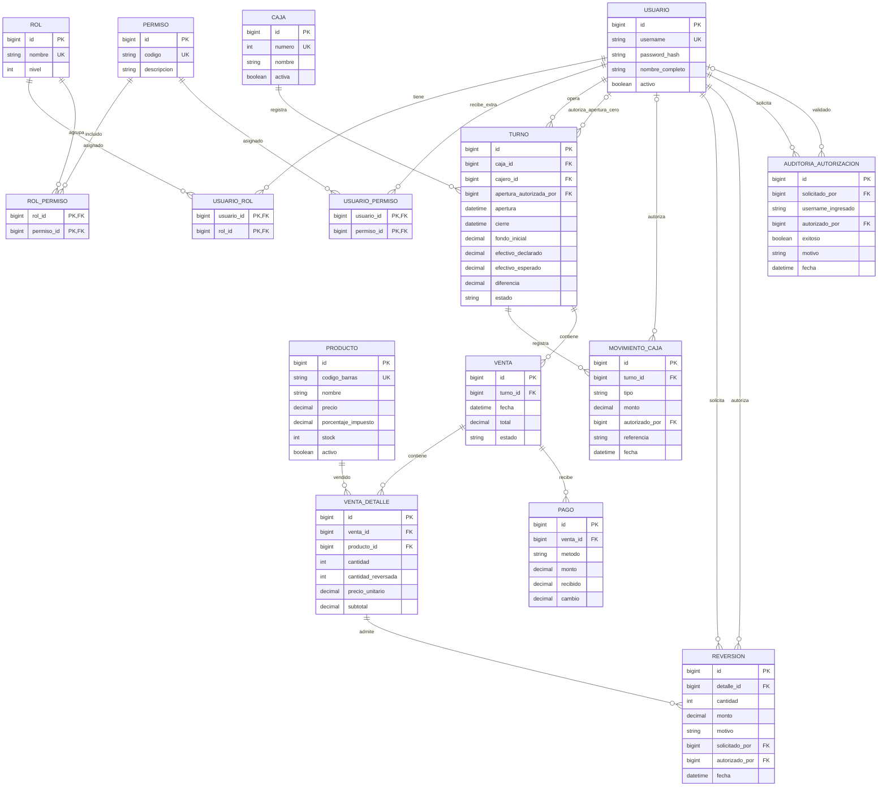

# Modelo entidad-relación del esquema actual

El diagrama muestra columnas y relaciones; `PK` identifica claves primarias,
`FK` referencias y `UK` valores únicos. Los tipos son lógicos; los scripts SQL
son la definición exacta de tipos Oracle, tamaños, nulabilidad y restricciones.
Los índices únicos de `turno` permiten solo un turno abierto por caja y por
cajero. Los turnos cerrados conservan el historial sin ocupar esos índices.

Los movimientos de fondo inicial se registran para auditoría, pero la fórmula
de efectivo toma el fondo del turno una sola vez. Los cobros suman el monto
aplicado en efectivo, no lo recibido antes de entregar cambio.

La tabla `auditoria_autorizacion` registra intentos exitosos y fallidos de
autorización de apertura con Q0, retiro a bóveda y reversión. La solicitud admite tres fallos y una sola
autorización exitosa. El turno guarda `apertura_autorizada_por`, y el movimiento
inicial registra el mismo autorizador. Una apertura positiva no lo necesita.

Las restricciones prohíben fondo negativo, fondo cero sin identificador de
autorizador y autoautorización. El servicio valida además las credenciales,
actividad, nivel y permiso del supervisor; la sesión del cajero no se sustituye.
Los retiros guardan receptor y referencia en movimiento_caja. Las reversiones
guardan solicitante, autorizador, cantidad, monto y motivo; actualizan detalle,
stock, estado y movimiento efectivo en una misma transacción. El cierre usa
los mismos importes y el mismo bloqueo de turno que las demás operaciones.
